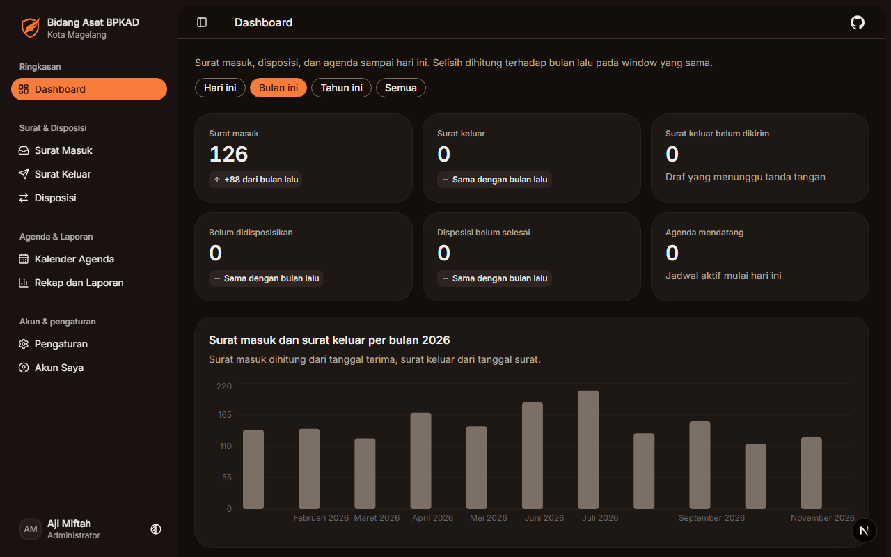
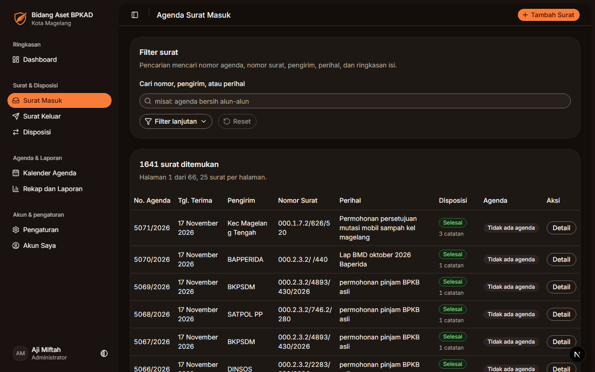
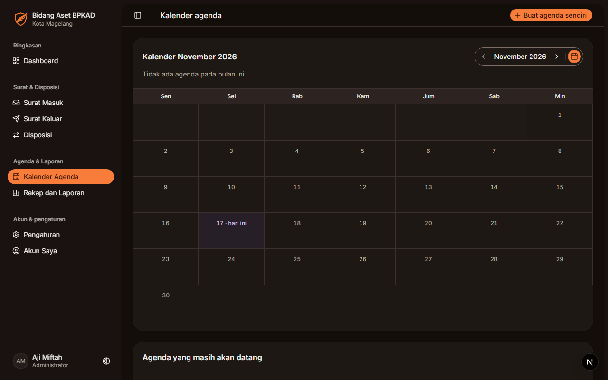
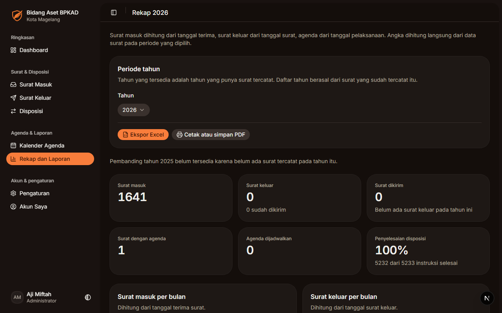
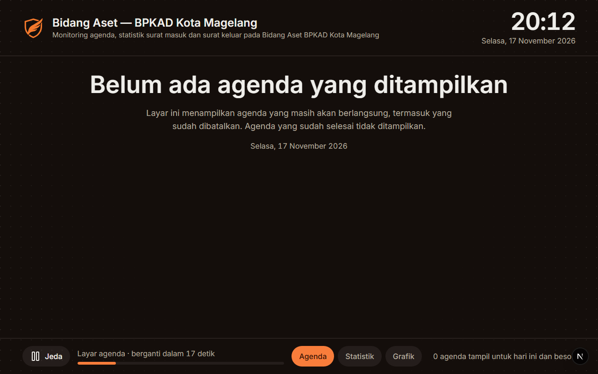
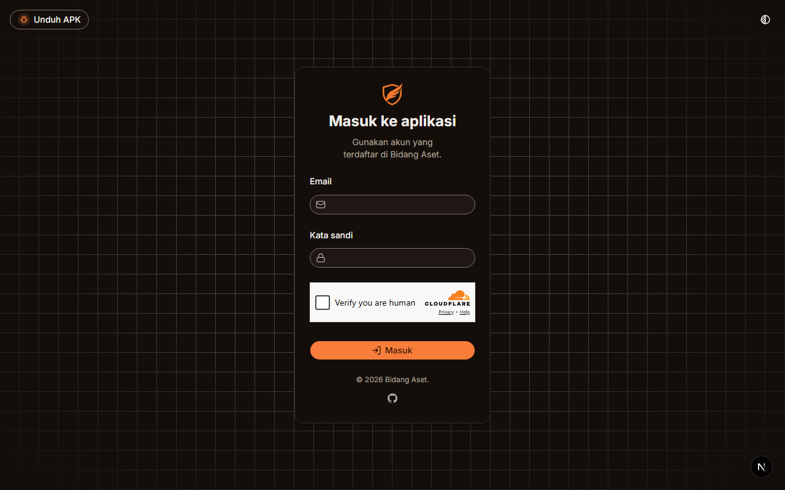

<div align="center">
  
  <h1>Bidang Aset — Sistem Agenda & Administrasi</h1>
  <p>
    Aplikasi web internal Bidang Aset BPKAD Kota Magelang untuk mengelola agenda
    surat masuk, disposisi, rapat, surat keluar, dan monitoring real-time.
  </p>
</div>

<p align="center">
  <a href="https://nextjs.org"></a>
  <a href="https://www.postgresql.org"></a>
  <a href="https://prisma.io"></a>
  <a href="https://github.com/forceware680/bidang-aset-android-public"></a>
  <a href="LICENSE"></a>
</p>

---

## Apa ini?

Satu aplikasi untuk seluruh siklus administrasi bidang aset: surat yang masuk dari
organisasi/SKPD lain diagendakan dengan nomor agenda otomatis, lalu didisposisikan ke
pejabat tujuan dengan tindak lanjut yang bisa dipantau; rapat dijadwalkan dengan
kalender dan peserta dipanggil lewat pemberitahuan; surat keluar dibuat dengan nomor
berurutan dan lampiran; dan ada layar monitor yang berganti sendiri (SSE) untuk dipasang
di ruang kerja. Semua perubahan tercatat sebagai jejak perubahan (audit trail).

Rekap bisa diekspor ke Excel untuk laporan bulanan. Ada pendamping Android (Flutter)
yang memakai API REST yang sama.

## Fitur utama

- **Agenda surat masuk** — nomor agenda otomatis per tahun (`NNN/2026`), kategori surat, pengirim, lampiran
- **Disposisi** — routing ke pejabat (kepala bidang → wali kota dan seterusnya), status tindak lanjut per disposisi
- **Agenda rapat** — jadwal + kalender, peserta, pemberitahuan, riwayat perubahan jadwal
- **Surat keluar** — nomor urut terpisah, lampiran, migrasi dari data lama
- **Rekap & ekspor Excel** — filter per periode, keluar sebagai `.xlsx` (SheetJS)
- **Monitor** — layar dashboard publik dengan token akses, refresh real-time via SSE, grafik statistik
- **Login** — Cloudflare Turnstile + sesi cookie HMAC-signed; tiga peran: Administrator, Petugas Agenda, Pembaca/Pimpinan
- **Jejak perubahan** — setiap insert/update/delete dicatat lengkap (siapa, fields apa, nilai sebelum/sesudah)
- **Pengaturan** — ganti URL download APK, token monitor, dan API token untuk pendamping Android

## Screenshot

| Dashboard | Agenda surat masuk |
|---|---|
|  |  |

| Kalender rapat | Rekap (dark) |
|---|---|
|  |  |

| Monitor (dark) | Login (dark) |
|---|---|
|  |  |

## Stack

Next.js 16 (App Router, server actions) · PostgreSQL · Prisma · Tailwind + shadcn/ui ·
SheetJS untuk ekspor Excel · SSE untuk monitor · Cloudflare Turnstile · Flutter untuk pendamping Android.

## Setup cepat

```bash
git clone https://github.com/forceware680/bidang-aset-web.git
cd bidang-aset-web
npm install

# buat .env dengan DATABASE_URL (PostgreSQL) dan SESSION_SECRET
# lalu:
npm run db:apply   # terapkan schema ke database
npm run dev        # http://localhost:3000
```

Release: `npm run build && npm run start`. Kalau dev server Turbopack bermasalah di
Windows, pakai `npm run dev:webpack`.

## Pendamping Android

Aplikasi Android (Flutter) untuk melihat kalender agenda dan mengelola agenda pribadi
dari HP, dengan alarm pengingat WIB. URL download APK bisa diatur dari halaman
pengaturan web. Repo:
[forceware680/bidang-aset-android-public](https://github.com/forceware680/bidang-aset-android-public).

## Lisensi

[MIT](LICENSE) — bebas dipakai, dimodifikasi, dan di-deploy secara privat.
